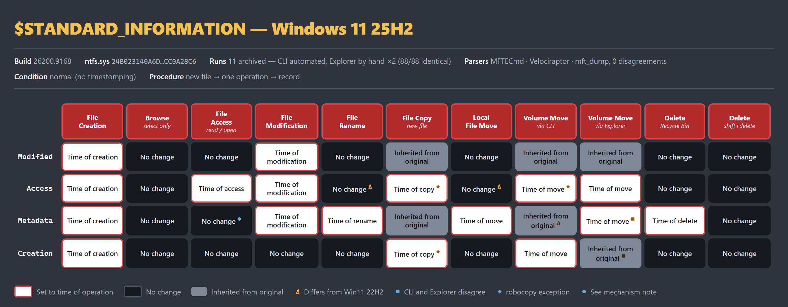
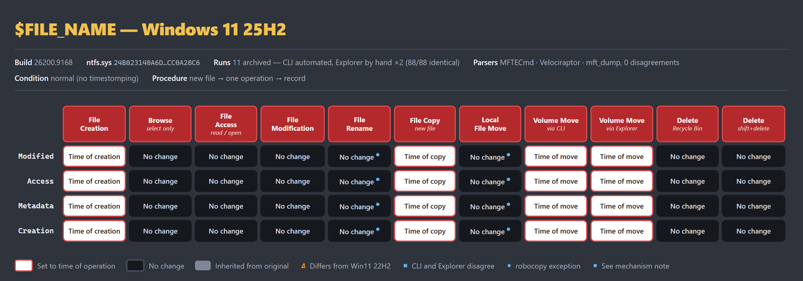

# Findings — Windows 11 25H2, build 26200.9168

## The rules at a glance

Operations across, timestamps down. Every difference from the published Windows 11 22H2 charts is flagged. The rest of this document is the evidence behind these two grids: what was measured, under which controls, and what each result does and does not support.

### `$STANDARD_INFORMATION`



### `$FILE_NAME`



> The images are generated from `charts/_si-rules.src.html` and `charts/_fn-rules.src.html`. To regenerate after a future build:
>
> ```powershell
> msedge --headless=new --disable-gpu --hide-scrollbars --force-device-scale-factor=2 `
>        --screenshot=charts\si-rules.png --window-size=1320,515 charts\_si-rules.src.html
> msedge --headless=new --disable-gpu --hide-scrollbars --force-device-scale-factor=2 `
>        --screenshot=charts\fn-rules.png --window-size=1320,462 charts\_fn-rules.src.html
> ```

## The core procedure

Every result below was produced the same way:

> **Create a brand-new file. Perform exactly one operation on it. Record the effect on all eight timestamps. Start over with a new file for the next operation.**

No file was used for two operations. Each cell comes from a file whose entire history is: created, then subjected to the single operation that cell names. See `docs/methodology.md` for why this is enforced structurally rather than by convention.

## Confidence basis

| Control | Result |
|---|---|
| Independent runs | 6 (`full01`, `full02`, `core01`, `vol_W256`, `vol_X64K`, `vol_Cphys`) |
| Normal-condition cells reproduced identically across runs | **100%** |
| Cases executed | 50, 50, 58, 58, 58, 58 — **0 failed** |
| Operations covered | 8 of 8 (`file_create` added in `core01`) |
| Volumes carrying the full matrix as primary | 4 (64 GB/4K, 256 GB/4K, 64 GB/64K, 999 GB physical) |
| Tool disagreements (MFTECmd / Velociraptor / mft_dump) | **0** |
| Environment drift (fingerprint before vs after) | **STABLE** both runs |
| Deferred updates (65-min late capture, `full02`) | **0** |

Every cell below was produced by at least two independent parsers in agreement, reproduced across two runs, and confirmed stable over a window longer than the NTFS last-access deferral period.

---

## 1. Differences from the published 22H2 charts

### 1.1 `$SI` Access no longer updates on in-place operations — CONFIRMED

| Operation | Mechanisms | 22H2 chart | Observed 25H2 |
|---|---|---|---|
| Rename | `Rename-Item`, `File.Move`, `cmd ren` | time of operation | **no change** |
| Local Move | `Move-Item`, `File.Move`, `cmd move` | time of operation | **no change** |

All six mechanisms agree, so this is not a tooling artifact. Three independent explanations were ruled out before accepting it:

- **Not a flush problem.** A plain-read control on the same volume, with the
same stomped starting value, updated access time immediately and was visible in the `$MFT` on the next flushed extraction.
- **Not a lazy-write problem.** The live Win32 read (`GetFileInformationByHandleEx`)
returned the *pre-operation* value immediately after the rename. The in-memory value never changed, so nothing was pending for a flush to write.
- **Not the one-hour deferral.** The timestomped variant set access to
2019-03-03, far outside the deferral window, which forces an update if one is coming. It still did not update. The 65-minute late capture showed zero deferred writes.

**Implication for analysts:** on 25H2, an unchanged `$SI` Access time no longer rules out a rename or a local move.

### 1.2 `$SI` Entry Modified inherited on cross-volume move — CONFIRMED

| Operation | Mechanisms | 22H2 chart | Observed 25H2 |
|---|---|---|---|
| Volume Move | `Move-Item`, `File.Move`, `cmd move`, `robocopy /MOV` | time of operation | **inherited from source** |

All four mechanisms agree. Note this sits beside `$SI` Creation correctly showing operation time, so the move writes some `$SI` fields from the source and others fresh — Modified and Entry Modified are carried over, Creation is not.

---

## 2. Not a change: robocopy

`robocopy` returned `inherited` for `$SI` Creation and Access where `copy`, `xcopy`, `Copy-Item` and `File.Copy` returned operation time, on both copy and cross-volume move.

This is **documented robocopy behavior, not an NTFS change**: the default `/COPY:DAT` copies Data, Attributes and **Timestamps**. The 22H2 charts simply did not test robocopy. It belongs on the exceptions list, not in the rule table. See `docs/exceptions.md` D7.

A robocopied file can legitimately appear to predate its arrival on the volume with no tampering involved.

---

## 3. Mechanism established under timestomping

**Not a field observation.** The following is visible only after `$SI` and `$FN` have been forced apart, and an analyst examining an ordinary file will see the section-1 normal value.

On **rename** and **local move**, all four `$FN` timestamps are repopulated from the file's **previous `$SI`** values, Creation included:

| `$FN` field | Source |
|---|---|
| Modified | previous `$SI` Modified |
| Access | previous `$SI` Access |
| Entry Modified | previous `$SI` Entry Modified |
| **Creation** | **previous `$SI` Creation** |

The 22H2 chart records `$FN` Creation as "No Change" on rename. That is **correct as a normal observable** — on an untampered file `$SI` and `$FN` already hold the same value, so repopulation is invisible. The two statements describe different things and both are accurate.

**Forensic consequence:** a file whose `$SI` was timestomped and which is then renamed or moved locally will have the stomped values **propagated into `$FN`**, destroying the `$SI`/`$FN` mismatch that would otherwise reveal the tampering. Timestomp-then-rename is therefore more effective at defeating `$SI`-vs-`$FN` comparison than timestomping alone.

---

## 4. Confirmed consistent with the 22H2 charts

Everything not listed above reproduced the published behavior, including the `$SI` Copy row where Modified and Entry Modified are **inherited from the original** while Access and Creation take the time of the copy — a cell that looks counterintuitive and was explicitly re-verified.

---

## 5. Volume geometry has no effect — MEASURED, not assumed

The complete matrix was run **four times, each with a different volume as the primary**, and every result compared cell-for-cell against the `V:` baseline.

| Volume | Size | Cluster | Backing | Cells compared | Identical |
|---|---|---|---|---|---|
| `V:` | 64 GB | 4K | VHDX | — | baseline |
| `W:` | 256 GB | 4K | VHDX | 232 | **232** |
| `X:` | 64 GB | 64K | VHDX | 232 | **232** |
| `C:` | 999 GB | 4K | VMware virtual disk | 232 | **232** |

Three questions settled:

**The historical 128 GB threshold does not apply on Win11 25H2.** `V:` sits below it and `W:` above it, with identical results. Windows has at times treated smaller volumes differently; on this build it does not.

**Allocation-unit size has no effect.** `V:` and `X:` are the same size with 4K and 64K clusters. Because volume size is held constant, this null result is clean — `V:` vs `W:` alone would have confounded size with cluster size.

**VHDX backing is transparent to NTFS timestamp behavior.** `C:` is a physical (VMware-backed) system volume rather than a VHDX file, and produced identical results. This converts "the hypervisor is not part of the apparatus" from an argument into a measurement, and it is the reason the VHDX-based procedure can be reproduced on any hypervisor without qualification.

A null result is the useful outcome here: the core rule tables generalise across volume size, cluster size and storage backing rather than describing one configuration.

## 6. Windows Search updates `$SI` Access on indexed files — CONFIRMED

The only measured condition in this study that **changed a rule**. Everything else — volume size, cluster size, storage backing, Microsoft Defender — produced no difference.

### The control

Four conditions. Only the indexer varies between the last two, which run against the *same path* with the *same* (absent) Defender exclusions:

| Run | Case location | Defender exclusions | Indexer | Differences vs clean room |
|---|---|---|---|---|
| `core01` | VHDX `V:` | yes | stopped | baseline |
| `realistic01` | VHDX `V:` | **none** | running, path **out of** index scope | **0** |
| `indexed01` | `C:\Users\…\Documents` | **none** | running, path **in** index scope | **15** |
| `noindex01` | `C:\Users\…\Documents` | **none** | **disabled** | **0** |

The differences appear with the indexer and disappear without it. Nothing else differs between those two runs.

### What changes

All fifteen differences are the Access timestamp:

| Operation | Clean room | Indexed location |
|---|---|---|
| Rename (all 3 mechanisms) | no change | set by the indexer, ~1 s later |
| Local move (all 3 mechanisms) | no change | set by the indexer, ~1 s later |
| Copy via robocopy | inherited | set by the indexer, ~2 s later |
| Read via .NET | time of operation | **no change** |

The last row runs the other way and is the one-hour deferral at work: the indexer had already set Access, so NTFS suppressed the update from the read that followed.

> **The operation does not write Access even here.** The classifier's `OP_TIME` label uses a ±2 s tolerance window, which is too coarse to separate "the operation set this" from "something else set it a second later". Comparing exact ticks shows the latter.

### The indexer's signature: Access trails Entry Modified

If a rename wrote Access, it would be part of the same atomic record update as Entry Modified and the two would be **identical to the tick**. They are not:

| Condition | `Access − EntryModified`, rename and local move |
|---|---|
| Indexed location, indexer running | **+0.007 s to +1.025 s** (mean +0.838) |
| Same location, indexer disabled | **−1,904 s to −2,345 s** (mean −2,125) |

With the indexer off, Access still holds its untouched creation-era value — roughly 35 minutes *before* the rename. With it on, Access lands about a second *after*. MFTECmd and Velociraptor agree to the tick on every case.

The same artifact appears on plain **file creation**, which normally writes all four values in one operation:

```
indexer OFF:  Creation = Modified = EntryModified = Access   (identical ticks)
indexer ON:   Creation = Modified = EntryModified
              Access   = +0.630 s / +1.023 s later
```

**Practical signature.** On a file in an indexed location, Access sitting a fraction of a second *after* three otherwise-identical `$SI` values is the indexer, not a user. A value written by the operation itself matches Entry Modified exactly.

The six `$FN` Access cells move from *indeterminate* to *prev `$SI`*. That is a measurement side effect, not a behavior change — the indexer pushed `$SI` Access away from `$FN` Access, making two values distinguishable that are normally identical. It usefully demonstrates that "indeterminate" is a limit of what is observable, not a property of NTFS.

### Detection consequence

**A changed `$SI` Access time on a file in an indexed location is not evidence of user access.** The indexer touches new files promptly, so the update lands close enough to the triggering operation to be mistaken for it.

**Sub-second analysis does not help here.** Zero-fraction rate was 0% and lossy restores 0 in *all three* conditions. The indexer performs a genuine read, so the resulting value carries normal 100 ns precision. That distinguishes it from software which reads a file and then writes a *reconstructed* timestamp back, losing the fraction — a pattern reported in some AV products, but **not** produced by Windows Search or by Defender on this build.

Note the loss is not an API limitation. `SetFileTime` preserves the full 100 ns fraction; verified here by writing `…03:03:03.1234567` and reading it back exactly from both the live record and the `$MFT`. A zeroed fraction means the *caller* supplied a whole-second value, not that the API could not carry one.

### Scope of the default index

On a default Windows 11 install the crawl scope is `C:\Users\` (excluding `AppData`) plus the Start Menu. Secondary volumes, and paths such as `C:\NtfsTest`, are **not** indexed. This is why `realistic01` — no exclusions at all, indexer running — showed no effect: the files were outside the scope. Check the scope before assuming either way:

```
HKLM:\SOFTWARE\Microsoft\Windows Search\CrawlScopeManager\Windows\SystemIndex\DefaultRules
```

### Microsoft Defender: no effect

`realistic01` ran with real-time protection on and **no exclusions anywhere**, and produced results identical to the clean room, with no zeroed fractions and no lossy restores. Defender on this build opens files without perturbing timestamps. This is a statement about Defender at this build, not about AV generally.

## 7. Explorer vs CLI — the only operation where the tool matters

Eleven Explorer cases, performed three times: twice by hand at the guest console (`explorer01`, `explorer02`) and once by the automated driver (`explorerauto01`, see [below](#automated-pass-reproduces-the-manual-passes)). **88 of 88 cells identical across all three passes**, zero unclassified, zero tool disagreements.

Explorer matches the CLI rules for **every** operation except the cross-volume move, where they differ on **two** cells — in opposite directions:

| `$SI` on volume move | CLI | Explorer | Which matches 22H2? |
|---|---|---|---|
| Modified | inherited | inherited | both |
| Access | time of move | time of move | both |
| **Metadata** | **inherited** | **time of move** | **Explorer** |
| **Creation** | **time of move** | **inherited** | **Explorer** |

Verified at 100 ns precision across all three passes — the destination's Creation is byte-identical to the source's:

```
pass 1   src Creation 2026-10-11T20:45:33.9524184Z
         dst Creation 2026-10-11T20:45:33.9524184Z   IDENTICAL
pass 2   src Creation 2026-10-11T22:35:32.7240246Z
         dst Creation 2026-10-11T22:35:32.7240246Z   IDENTICAL
pass 3   src Creation 2026-10-24T16:00:21.9530772Z
         dst Creation 2026-10-24T16:00:21.9530772Z   IDENTICAL   (automated)
```

So the 22H2 charts' Explorer/CLI split on Creation is real and still holds. **The Metadata divergence is new**, and it is *CLI* that departs from 22H2 there — narrowing finding §1.2, which otherwise reads as though it applied to cross-volume moves generally.

Explorer cut/paste and Shift+drag produce identical results. Cross-volume drag without Shift is a **copy**, and matches the Copy column exactly.

### Also measured, with no prior published baseline

| Case | Result |
|---|---|
| **Browse / select** in Explorer | **Nothing changes.** All eight timestamps unmoved. "Accessed" means opened, not listed. |
| **Open** from Explorer (Notepad) | Access **and Metadata** update. A programmatic read leaves Metadata alone. The Metadata change comes from the shell, not from NTFS or Notepad ([below](#why-explorer-changes-entry-modified-object-ids)). |
| **Recycle Bin delete** | Updates **Metadata** only, like a local move — it *is* a move into `$Recycle.Bin` plus a rename to `$R…`. |
| **Shift+delete** | Every timestamp unchanged. Matches the CLI delete rules. |

If Metadata moved at deletion time, the file went to the Recycle Bin rather than being permanently deleted.

### Why Explorer changes Entry Modified: object IDs

Opening a file from Explorer changes `$SI` Entry Modified although Notepad only reads the file. The change comes from the shell's link tracking:

1. Explorer adds the file to Recent Items by creating a shortcut in `%APPDATA%\Microsoft\Windows\Recent`.
2. The shortcut's link-tracking block identifies the target by its NTFS object ID, so that the shortcut can still find the file after a rename or move. A file without an object ID is given one, which adds an `$OBJECT_ID` attribute to its MFT record.
3. Changing the record updates Entry Modified.

Measured in `explorerauto01`, case 02:

| Time (UTC) | Event |
|---|---|
| 16:01:10.699 | Entry Modified changes. The file had no object ID before the open and has `98119dff-cbbe-11f1-8cee-000c296f03cc` after it. |
| 16:01:10.767 | The Recent shortcut for the file is created. Its link-tracking block holds the same object ID. |
| 16:01:11.084 | Access changes as Notepad reads the file. |

Explorer adds object IDs on more than "open". The same files gained one in all three passes:

| Gains an object ID | Does not |
|---|---|
| Open (02), rename (03), local move by cut/paste or drag (05, 06), the destination file of a cross-volume move (07, 08) | Browse (01), copy (04, 09; source or destination), Recycle Bin delete (10) |

Only "open" creates a Recent shortcut, so for rename and moves the object ID comes from Explorer's file operations rather than Recent Items. None of the case files in the scripted run `core01` has an object ID, on either volume. For rename and local move, the record changes anyway, so the object ID changes no table cell.

**The likely cause of the cross-volume Metadata divergence.** A command-line cross-volume move leaves the destination's Entry Modified inherited from the source, while Explorer's sets it to the time of the move. Explorer also gives the destination file an object ID, which changes its record after the copy. That would also explain Access being written up to 21 ms *before* Entry Modified on these cases (below). It fits all three passes but is not yet tested directly; moving a file that already has an object ID would settle it.

**Forensic reading.**

- An `$OBJECT_ID` on a file is consistent with Explorer having opened, renamed or moved it. Its absence proves nothing: copies, deletes and command-line operations do not add one. Other software can add one too.
- A Recent shortcut's link-tracking block names the target's object ID, so it identifies the file even after a rename or move.
- The object ID is a version-1 GUID, but its embedded timestamp does not date the assignment. In these runs, the IDs assigned in one session shared a base time 8 hours to 5 days before the operations, and increased in the order they were assigned. Its last 12 hex digits are a network adapter's MAC address, here the VM's.

### Incidental: short-name renames drop the second `$FN`

Pass 2 renamed its case to `ren02.txt`, which fits 8.3. `HardLinkCount` fell from **2 to 1** — the short-name `$FILE_NAME` attribute is not created when the long name already conforms. **Timestamp results were identical either way**, so the rules hold regardless of how many `$FN` attributes a record carries. Worth knowing when reading `$FN` data: one attribute is not evidence of tampering.

### Automated pass reproduces the manual passes

`explorerauto01` performed the same eleven cases with `Invoke-ExplorerDriver.ps1`, which acts in the logged-on user's desktop session with real mouse and keyboard input (see `docs/explorer-test-plan.md`). All 11 cases passed the driver's self-checks, and the result agrees with both manual passes on **all 88 cells**.

| | `explorer01` | `explorer02` | `explorerauto01` |
|---|---|---|---|
| Performed by | operator | operator | automated driver |
| Cells agreeing with the other passes | 88 / 88 | 88 / 88 | 88 / 88 |
| Measured window per case | 7 – 58 s | 11 – 86 s | 0.1 – 3.1 s |

Case for case, the driver's windows are 7 to 170 times narrower than an operator's, and no result changed. None of the Explorer results depended on the wide manual windows: every timestamp change attributed to an operation landed within the driver's window or the classifier's 2-second tolerance around it.

Two sub-second details are worth recording. Neither changes a rule-table cell.

- **Cross-volume moves (cases 07 and 08).** `$SI` Access is written up to 21 ms *before* Entry Modified, or on the same tick. The ordering varies from pass to pass, including between the two manual passes, so it is Explorer's behavior rather than the driver's. Both values fall within the move and classify as the time of the move in every pass. The `PRECEDES` label these cases receive in `access-vs-entrymodified.csv` is therefore not evidence that the move left Access alone. The object ID Explorer adds after the copy is the likely reason ([above](#why-explorer-changes-entry-modified-object-ids)).
- **Open (case 02).** Access trails Entry Modified by 0.09 to 0.39 seconds in all three passes. The two are written by separate steps: Entry Modified when the shell adds the object ID, then Access when Notepad reads the file.

## 8. Scope

The scripted matrix ran with each of four volumes as the primary (§5): `V:` (64 GB, 4K clusters), `W:` (256 GB, 4K), `X:` (64 GB, 64K) and the `C:` system volume (999 GB, 4K). The Explorer cases ran on `V:`, with `W:` as the cross-volume destination. Every volume had 8.3 short names enabled, last-access updating enabled and tunneling at default. Explorer-driven mechanisms are covered in §7: eleven cases, two manual passes and one automated pass. Recycle Bin deletion is covered through Explorer only (case 10). Folder operations and copy-over-existing were out of scope for this pass.

Read `docs/exceptions.md` before applying these rules to real evidence.
